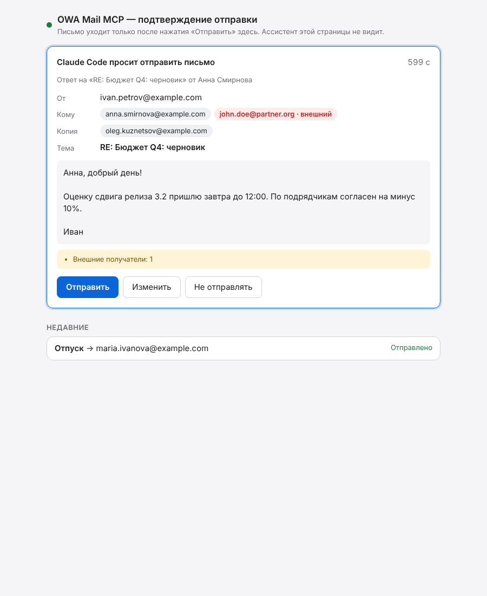
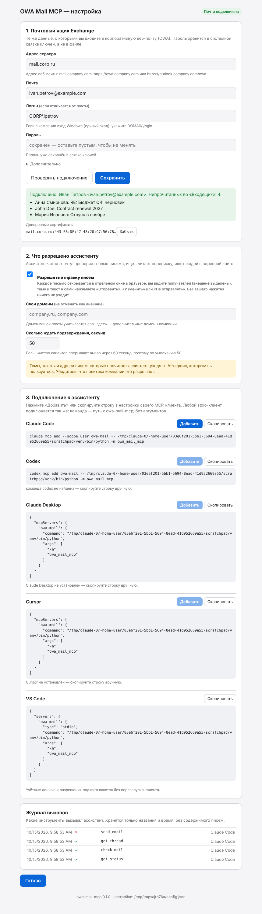
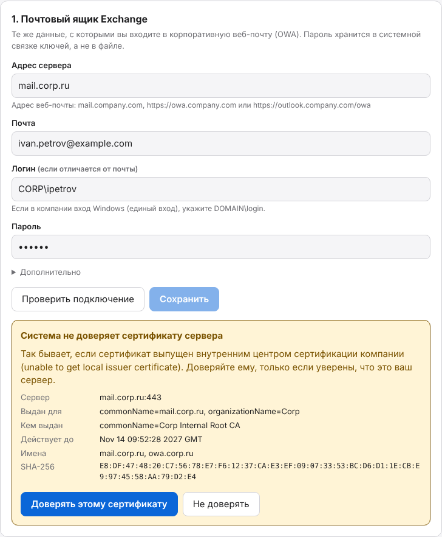

# owa-mail-mcp

MCP-сервер для почты Microsoft Exchange / OWA. Даёт AI-ассистенту (Claude Code, Claude Desktop, Codex, Cursor, OpenCode, Kilo Code и любому stdio MCP-клиенту) доступ к почтовому ящику:

- **проверять почту:** новые и непрочитанные письма;
- **искать сообщения:** по тексту, отправителю, получателю, теме, датам, вложениям;
- **читать и суммаризировать треды:** вся переписка из «Входящих», «Отправленных» и других папок, по порядку, без процитированной истории;
- **находить отправителей:** кто пишет и сколько, кто ждёт ответа, поиск людей в адресной книге организации;
- **отправлять письма**, но только после того, как пользователь нажмёт «Отправить» в отдельном окне на своём компьютере.

Сайт с инструкцией: **https://khomiakov7706.github.io/owa-mail-mcp/** (также [English](https://khomiakov7706.github.io/owa-mail-mcp/en/), [中文](https://khomiakov7706.github.io/owa-mail-mcp/zh/), [Español](https://khomiakov7706.github.io/owa-mail-mcp/es/))

<p align="center"></p>

## Быстрый старт

macOS или Linux, одна команда в терминале:

```bash
curl -LsSf https://raw.githubusercontent.com/Khomiakov7706/owa-mail-mcp/main/install.sh | sh
```

Скрипт ставит [uv](https://docs.astral.sh/uv/) (менеджер Python от Astral), а через него — owa-mail-mcp в отдельное окружение на Python 3.12, который uv скачает сам. Системный Python не используется: на macOS это 3.9, а MCP SDK нужен 3.10+. Повторный запуск той же команды обновляет программу. Настройки при этом сохраняются: они лежат не в папке программы, а в `config.json` (см. ниже) и в системной связке ключей, поэтому установщик, увидев готовые настройки, окно не открывает. Если после обновления macOS спросит, разрешить ли доступ к связке ключей, нажмите «Всегда разрешать». Проверить, что всё на месте: `owa-mail-mcp status`. После обновления перезапустите MCP-сервер в клиенте (Claude Code: `/mcp` → owa-mail → Reconnect; Claude Desktop и Cursor: закрыть и открыть приложение): клиент держит запущенный процесс со старым кодом. Если забыть, ошибки инструментов сами подскажут, что нужен перезапуск, а `get_status` покажет версию и `restart_needed`. В конце открывается окно настройки. Если почта открывается только из корпоративной сети, включите VPN.

### Установка через агента

Агенту с терминалом на вашем компьютере (Claude Code, Codex, Cursor, OpenCode, Kilo Code) можно отправить:

```text
Установи и подключи MCP-сервер OWA Mail для моей рабочей почты Exchange.
Следуй инструкции для агентов шаг за шагом: https://khomiakov7706.github.io/owa-mail-mcp/agent-install.md
Пароль у меня не спрашивай — я введу его сам в окне настройки.
```

[Инструкция для агентов](docs/agent-install.md) описывает весь путь: проверка (`status --json`), установка без блокирующего окна (`OWA_MAIL_MCP_NO_SETUP=1`), подключение к клиенту (`connect`), окно настройки в фоне с заполненными адресом и почтой (`setup --server --email`), ожидание, проверка (`check`), перезапуск клиента и разбор ошибок. Пароль агент не видит и настройки безопасности за пользователя не меняет; если агент работает в облаке или песочнице, он отдаёт команды пользователю.

<details>
<summary>Другие способы установки</summary>

Windows (PowerShell):

```powershell
powershell -ExecutionPolicy ByPass -c "irm https://astral.sh/uv/install.ps1 | iex"
uv tool install --python 3.12 git+https://github.com/Khomiakov7706/owa-mail-mcp
owa-mail-mcp setup
```

Если uv уже есть: `uv tool install --python 3.12 git+https://github.com/Khomiakov7706/owa-mail-mcp`.

pipx с Python 3.10+: `pipx install --python python3.12 git+https://github.com/Khomiakov7706/owa-mail-mcp`.

Ошибка `Could not find a version that satisfies the requirement mcp` означает, что установка шла системным Python 3.9: используйте скрипт выше или uv.
</details>

Окно настройки открывается в браузере, на языке системы (русский, English, 中文, Español; сменить — в правом верхнем углу окна). В нём три шага:

1. **Почтовый ящик Exchange.** Адрес веб-почты, почта, логин (`DOMAIN\login`, если вход Windows) и пароль, затем «Проверить подключение». При успехе видно ваше имя, число непрочитанных и последние письма. Если сервер недоступен, окно подскажет про VPN; если не подошёл пароль, так и скажет. Пароль сохраняется в системной связке ключей (Keychain, Credential Manager, Secret Service), а не в файле.
2. **Что разрешено ассистенту.** По умолчанию только чтение. Переключатель «Разрешить отправку писем»; каждое письмо всё равно подтверждаете вы.
3. **Подключение к ассистенту.** Кнопка «Добавить» для Claude Code, Codex, Claude Desktop, Cursor, OpenCode и Kilo Code, плюс готовые строки с кнопкой «Скопировать» для них и для VS Code.

### Конфиги клиентов вручную

В примерах замените `/Users/YOU` на свою домашнюю папку (точный путь показывает окно настройки).

| Клиент | Как подключить |
|---|---|
| Claude Code | `claude mcp add --scope user owa-mail -- ~/.local/bin/owa-mail-mcp` |
| Codex | `codex mcp add owa-mail -- ~/.local/bin/owa-mail-mcp` |
| Claude Desktop, Cursor | `{"mcpServers": {"owa-mail": {"command": "/Users/YOU/.local/bin/owa-mail-mcp"}}}` в `claude_desktop_config.json` / `~/.cursor/mcp.json` |
| OpenCode | `~/.config/opencode/opencode.json`, формат ниже |
| Kilo Code (новые версии) | `~/.config/kilo/kilo.jsonc`, тот же формат, что у OpenCode |
| Kilo Code (старые версии) | «Edit Global MCP» (`mcp_settings.json`) или `.kilocode/mcp.json`, формат `mcpServers` ниже |

OpenCode и новый Kilo Code не читают ключ `mcpServers`: у них ключ `mcp`, `"type": "local"` и команда массивом.

```json
{
  "$schema": "https://opencode.ai/config.json",
  "mcp": {
    "owa-mail": {
      "type": "local",
      "command": ["/Users/YOU/.local/bin/owa-mail-mcp"],
      "enabled": true
    }
  }
}
```

Kilo Code, старые версии:

```json
{
  "mcpServers": {
    "owa-mail": {
      "command": "/Users/YOU/.local/bin/owa-mail-mcp",
      "args": [],
      "disabled": false,
      "alwaysAllow": []
    }
  }
}
```

Ниже — журнал: какие инструменты и когда вызывал ассистент, без содержимого писем.

<p align="center"></p>

**Сертификат, выпущенный внутри компании.** Если система не доверяет сертификату Exchange, проверка подключения покажет его: для кого и кем выдан, срок действия и отпечаток SHA-256. После «Доверять этому сертификату» сервер принимает именно этот сертификат (pinning) — проверку TLS для него никто не отключает. Если сертификат потом сменится, окно покажет старый и новый отпечатки: так плановую замену можно отличить от перехвата.

<p align="center"></p>

**Если браузер открывает почту, а проверка пишет «не удаётся соединиться».** Проверка идёт к серверу тем же путём, что и вся программа: напрямую или через системный прокси (переменные `HTTPS_PROXY` и прокси из настроек macOS/Windows). Если сообщение называет конкретную причину, действуйте по ней:

- **DNS:** имя сервера не находится. Переподключите VPN.
- **Прокси:** указанный или системный прокси отказал в соединении.
- **TLS:** защищённое соединение не установилось.

Если браузер ходит через прокси, заданный PAC-скриптом (автоматическая настройка прокси), программа этот скрипт не читает. Окно подскажет, если в macOS включён PAC; адрес прокси тогда указывается в «Дополнительно» → «Прокси». Старые Exchange и шлюзы перед ними иногда работают только с устаревшими настройками TLS, которые браузеры принимают, а OpenSSL 3 нет. Окно распознает это и предложит разрешить их только для этого сервера; сертификат по-прежнему проверяется.

**Если ассистента подключили раньше, чем почту.** На первом же вызове MCP-сервер сам откроет окно настройки, а ассистент получит ответ «пользователь настраивает почту в открывшемся окне». Перезапускать клиент после настройки не нужно: сервер перечитывает настройки на лету, а новый пароль снимает блокировку, которую поставил отклонённый.

Попробовать без Exchange, на встроенном демо-ящике:

```bash
claude mcp add owa-mail-demo -e OWA_MAIL_BACKEND=demo -e OWA_MAIL_ALLOW_SEND=1 -- owa-mail-mcp serve
```

### Команды

| Команда | Что делает |
|---|---|
| `owa-mail-mcp` | В терминале открывает окно настройки (новый терминал после установки: скрипт добавляет `~/.local/bin` в PATH); запущенная MCP-клиентом работает как stdio-сервер |
| `owa-mail-mcp setup` | Окно настройки (`--no-browser` — только вывести адрес; `--server`, `--email`, `--username` — заполнить поля заранее) |
| `owa-mail-mcp serve` | MCP-сервер по stdio |
| `owa-mail-mcp status` | Версия, где лежат настройки, сохранён ли пароль (код 0 — настроено, 2 — нет; `--json` — для агентов) |
| `owa-mail-mcp connect <клиент>` | Подключить сервер к клиенту: `claude-code`, `codex`, `claude-desktop`, `cursor`, `opencode`, `kilo`; `--list` — какие найдены |
| `owa-mail-mcp check` | Проверить сохранённое подключение из терминала |
| `owa-mail-mcp diagnose` | Показать, что сервер отвечает на адресах EWS и OWA (коды, перенаправления, способы входа), без паролей и содержимого |

### Где лежат настройки и переменные окружения

Окно настройки пишет `config.json` (доступный только вашему пользователю) в `~/Library/Application Support/owa-mail-mcp` на macOS, `%APPDATA%\owa-mail-mcp` на Windows, `~/.config/owa-mail-mcp` на Linux. Там же хранится журнал вызовов. Переменные окружения переопределяют файл; это удобно для серверов без браузера и без связки ключей:

| Переменная | Что задаёт |
|---|---|
| `OWA_MAIL_SERVER`, `OWA_MAIL_EMAIL`, `OWA_MAIL_USERNAME`, `OWA_MAIL_PASSWORD` | Подключение без окна настройки |
| `OWA_MAIL_AUTH` | `ntlm` (по умолчанию), `basic`, `kerberos` |
| `OWA_MAIL_ALLOW_SEND` | `1` — разрешить отправку |
| `OWA_MAIL_CONFIRM_TIMEOUT` | Сколько секунд ждать подтверждения (по умолчанию 50) |
| `OWA_MAIL_INTERNAL_DOMAINS` | Свои домены через запятую |
| `OWA_MAIL_OPEN_BROWSER` | `0` — не открывать браузер, а выводить адрес окна в stderr |
| `OWA_MAIL_BACKEND` | `demo` — встроенный демо-ящик |
| `OWA_MAIL_PROXY` | HTTPS-прокси до Exchange (`host:port`), если его нет в системных настройках |
| `OWA_MAIL_LANG` | Язык окон и сообщений: `ru`, `en`, `zh`, `es` (по умолчанию — язык системы или выбранный в окне настройки) |
| `OWA_MAIL_CONFIG_DIR` | Другая папка настроек |

## Инструменты

| Инструмент | Что делает |
|---|---|
| `get_status` | Кто пользователь (адрес, имя), текущее время, число непрочитанных, включена ли отправка |
| `check_mail` | Новые письма во «Входящих» (по умолчанию непрочитанные) с превью |
| `search_messages` | Поиск по тексту, отправителю, получателю, теме, датам (`7d`, `yesterday`, `2026-10-01`), вложениям, папкам |
| `get_message` | Полный текст письма (HTML переводится в текст), список вложений |
| `get_attachment` | Текст вложения: транскрипты и документы (.docx, .pdf, .txt, .vtt/.srt, .md, .csv, .html) и вложенные письма |
| `get_thread` | Вся переписка по письму, по порядку, без процитированной истории, со списком участников |
| `find_people` | Поиск в адресной книге организации (GAL) и контактах: имя, адрес, должность, отдел |
| `list_senders` | Кто писал за период: число писем, непрочитанные, последняя тема; для `sent` — кому писали вы |
| `send_email` | Новое письмо или ответ (`reply_to_message_id`, `reply_all`) **после подтверждения в окне** |

Промпты: `summarize_thread` (сводка переписки) и `triage_inbox` (разбор входящих: на что ответить, что для сведения).

Пример запроса к ассистенту: *«Что нового в почте со вчерашнего дня? Сделай сводку по треду про бюджет Q4 и подготовь ответ Анне, что оценку пришлю завтра»*. Ассистент вызовет `check_mail`, `get_thread`, затем `send_email`; в браузере откроется окно, где можно отправить письмо, отказаться или поправить текст и получателей.

## Как устроено подтверждение отправки

```
MCP-клиент ──stdio──► owa-mail-mcp ──EWS (HTTPS, NTLM)──► Exchange
                           │
                           └── http://127.0.0.1:<порт>/t/<секрет>/  ◄── браузер пользователя
```

1. `send_email` проверяет письмо: адреса только ASCII (кириллическая «е» в домене не пройдёт), запрещены управляющие символы направления текста (с ними `moc.live@ivan` выглядит как `ivan@evil.com`), лимит получателей, непустые тема и текст. Невидимые символы и скрытые копии выделяются предупреждением, внешние получатели — красным.
2. Письмо попадает в очередь (не больше трёх ожидающих), и сервер открывает в браузере локальную страницу. Её адрес содержит случайный секрет, который ассистент не видит.
3. Пока пользователь думает, вызов ждёт; клиентам, которые это поддерживают, раз в секунду отправляется progress.
4. **Отправить** — письмо уходит, ассистент получает `sent: true` и то, что реально отправлено. **Изменить** — пользователь правит получателей, тему и текст; уходит исправленная версия, ассистент получает `edited_by_user: true`. **Не отправлять** или истёкшее время — ассистент получает ошибку «ничего не отправлено, не повторяй без просьбы».
5. Повтор того же вызова в течение 10 минут возвращает первый результат (`duplicate: true`), а не второе письмо.

Ответ на кнопку приходит только из окна, никогда из MCP-клиента: модель можно уговорить чем угодно через текст письма, которое она только что прочитала. Окно слушает только loopback, не открывается во фрейме (`X-Frame-Options`, CSP `frame-ancestors 'none'`), принимает только JSON и проверяет `Host`/`Origin`, так что чужая веб-страница или DNS rebinding не нажмут кнопку за вас.

**Граница защиты:** если у агента есть неограниченный shell от вашего пользователя, он может прочитать и пароль из keyring, и адрес окна. Подтверждение защищает от агента, которым манипулируют через содержимое писем, но не от агента, у которого уже есть полный доступ к машине.

## Другие меры защиты

- **Только чтение по умолчанию.** Отправка включается отдельным переключателем в окне настройки; до этого `send_email` отвечает, что отправка выключена.
- **Защита от блокировки учётной записи.** После первого отказа Exchange в пароле сервер перестаёт ходить в Exchange, пока пароль не введут заново в окне настройки, поэтому зациклившийся агент не заблокирует доменную учётку в AD. Есть и ограничение частоты: 120 запросов в минуту, не больше двух одновременно.
- **Содержимое писем — данные.** Инструкции сервера и описания инструментов прямо говорят модели не выполнять указания из писем.
- **stdout только для протокола.** Логи идут в stderr, в них нет тем, адресов и текстов писем.
- **Только HTTPS и pinning.** На `http://` пароль не отправляется; сертификату, которому не доверяет система, доверяют только явно и только по отпечатку.

## Чего программа не решает

Независимого аудита у программы ещё не было.

1. **Почта уходит AI-сервису.** Всё, что читает агент (тексты, вложения, транскрибации), отправляется компании, которая обслуживает агента. Для банка или другой регулируемой компании нужно согласие службы ИБ.
2. **Письма с «командами» для агента.** Просьба считать письма данными — не замок. Настоящая защита — окно подтверждения. Читать агент может всё; ограничить его папками пока нельзя.
3. **Способ установки.** `curl … | sh` ставит то, что сейчас в ветке main; подписанных релизов и фиксированных версий пока нет.
4. **Настройки, ослабляющие защиту** (выключены по умолчанию): устаревшие настройки TLS для сервера и пароль в `OWA_MAIL_PASSWORD` вместо связки ключей.
5. **Доступ к компьютеру.** Тот, кто уже вошёл под вашей учётной записью, может воспользоваться сохранённым паролем и запущенной программой.

Перед подключением рабочей почты: согласуйте со службой ИБ, держите отправку выключенной без необходимости, закажите независимую проверку и ставьте фиксированную версию.

## Почему EWS, а не OWA `service.svc`

OWA и EWS живут на одном сервере (`/owa` и `/EWS/Exchange.asmx`) и принимают одни и те же доменные учётные данные. Веб-клиент OWA ходит во внутренние JSON-вызовы (`/owa/service.svc?action=...` с токеном `X-OWA-CANARY`), но они не документированы. Для почты EWS удобнее: это документированный стабильный API, есть зрелая библиотека [exchangelib](https://github.com/ecederstrand/exchangelib), а у `service.svc` формат запросов меняется от версии к версии.

Если в вашей организации EWS закрыт, а OWA работает, бэкенд можно заменить: инструменты работают через интерфейс `MailBackend` (`src/owa_mail_mcp/backend.py`), и бэкенд на `service.svc` пишется отдельно, без изменений в инструментах и окне подтверждения.

Для Exchange Online (Microsoft 365) Microsoft отключает Basic auth и выводит EWS из эксплуатации; для облачной почты лучше взять сервер на Microsoft Graph (см. ниже).

## Готовые решения, которые стоит знать

Перед созданием проекта я посмотрел, что уже есть. Звёзды и активность проверяйте сами: доступ к поиску GitHub из этой среды был ограничен, часть данных взята из каталогов MCP-серверов.

| Проект | Протокол | Подходит для | Как с отправкой |
|---|---|---|---|
| [a-lagutov/outlook-ews-mcp](https://github.com/a-lagutov/outlook-ews-mcp), [viartemev/outlook-ews-mcp](https://github.com/viartemev/outlook-ews-mcp) | EWS (exchangelib), NTLM/Basic | On-prem Exchange: почта, календарь, контакты, вложения | Черновики + `send_draft`; подтверждение на стороне клиента |
| [ShermanGu/exchange-ews-mcp](https://glama.ai/mcp/servers/ShermanGu/exchange-ews-mcp) | EWS, NTLM, Windows | On-prem Exchange | Draft-first: письма создаются только как черновики |
| [askarzh/exchange-mcp](https://github.com/askarzh/exchange-mcp) | EWS + демон на Postgres | Архив и поиск по большому ящику | `SEND_ENABLED=false` по умолчанию |
| [azizmazrou/ews-mcp](https://github.com/azizmazrou/ews-mcp) | EWS | On-prem Exchange | Отправка выключена по умолчанию |
| [Softeria/ms-365-mcp-server](https://github.com/Softeria/ms-365-mcp-server) | Microsoft Graph | Microsoft 365 / Outlook.com | `send-mail` без отдельного подтверждения |
| [elyxlz/microsoft-mcp](https://github.com/elyxlz/microsoft-mcp) | Microsoft Graph | Microsoft 365, несколько аккаунтов | Без отдельного подтверждения |
| [tecnologicachile/mail-mcp](https://mcpservers.org/servers/tecnologicachile/mail-mcp) | IMAP/SMTP, Graph, EWS (OAuth) | Смешанные ящики | Запись включается переменными |
| [agimenez-dev/imap-mcp](https://glama.ai/mcp/servers/agimenezdev/imap-mcp) | IMAP/SMTP | Обычная почта | `mail_send` сначала возвращает превью, отправка с `confirm=true` |

Вывод: для on-prem Exchange уже есть рабочие серверы на exchangelib, и для простого чтения почты их достаточно. Но подтверждение отправки у них либо отсутствует, либо реализовано как «черновик + второй вызов» или `confirm=true`. И то и другое решает сама модель, а значит, его может обойти prompt injection. Этот проект добавляет то, чего не хватает: подтверждение, которое модель нажать не может, с выделением внешних получателей и возможностью править письмо, а также инструменты под конкретные задачи (треды без цитат, статистика отправителей, разбор входящих).

Ещё один путь — MCP elicitation (запрос подтверждения через UI самого клиента, спецификация 2025-06-18). Claude Code её поддерживает, Claude Desktop и многие другие клиенты нет, поэтому здесь используется собственное окно, которое работает с любым клиентом.

## Разработка

```bash
python -m venv .venv && . .venv/bin/activate
pip install -e ".[dev]"
pytest
OWA_MAIL_BACKEND=demo OWA_MAIL_ALLOW_SEND=1 owa-mail-mcp -v   # stdio-сервер на демо-ящике
```

Тесты проходят полный цикл на демо-бэкенде: MCP-клиент → `send_email` → HTTP окна подтверждения → решение пользователя → отправка, а также отказ, тайм-аут, правки, дубликаты, проверки текста и защиту окна от чужих запросов. Окно настройки проверяется так же: проверка подключения, разбор ошибок, доверие сертификату и его смена, сохранение без пароля в файле, запись в конфиг Claude Desktop, подхват настроек работающим сервером. Pinning проверен на локальном HTTPS-сервере с самоподписанным сертификатом. EWS-бэкенд с живым Exchange не проверялся; первым шагом на реальном сервере нажмите «Проверить подключение».

```
src/owa_mail_mcp/
  server.py          инструменты, инструкции и промпты MCP, журнал вызовов
  runtime.py         текущие настройки и бэкенд, подхват изменений на лету, журнал
  setup.py           окно настройки: проверка подключения, сертификаты, установка в клиенты
  setup_page.html    страница окна настройки
  config.py          config.json, переменные окружения, связка ключей
  tls.py             просмотр сертификата и pinning по отпечатку
  backend.py         интерфейс MailBackend
  ews_backend.py     Exchange через exchangelib
  demo_backend.py    демо-ящик в памяти
  confirm.py         очередь писем, ожидающих решения
  ui.py              окно подтверждения отправки
  confirm_page.html  страница окна подтверждения
  web.py             общая основа локальных окон (loopback, секретный адрес, CSP)
  safety.py          проверки исходящих писем, лимит запросов, блокировка после отказа в пароле
  text.py            HTML → текст, отрезание цитат, правила для текста
```

## Лицензия

MIT
